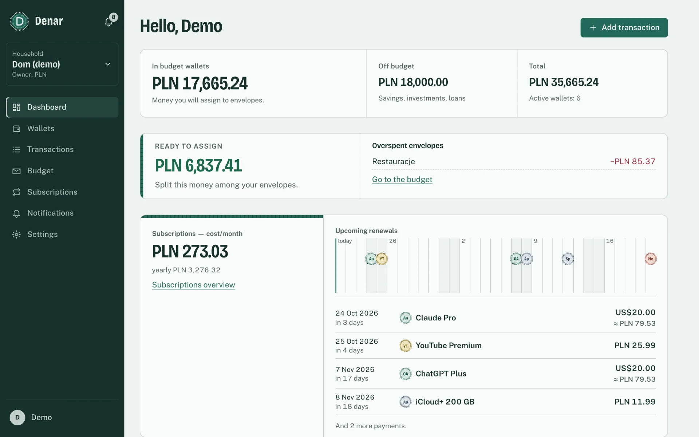
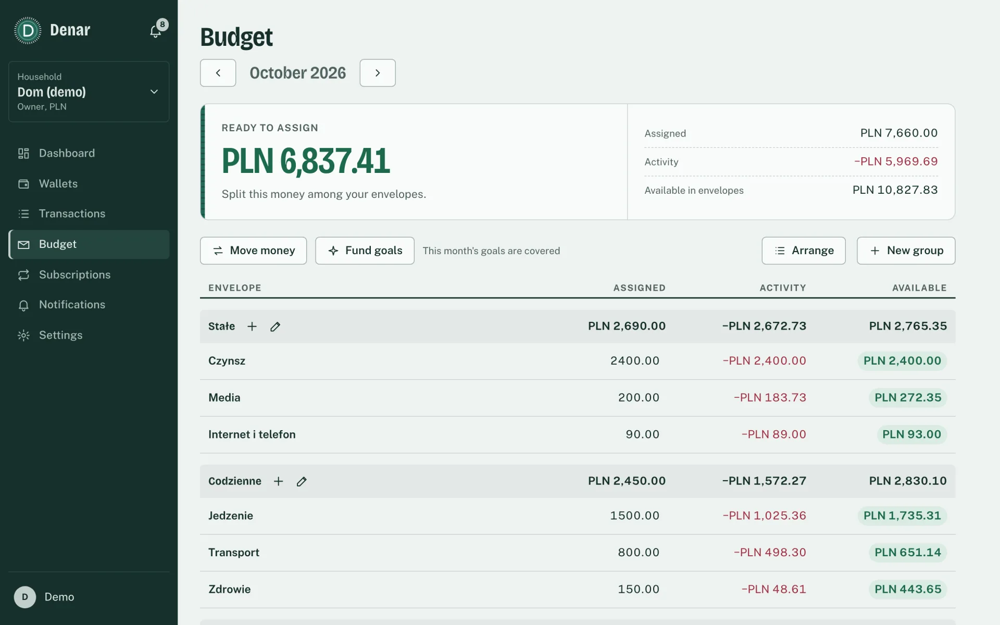
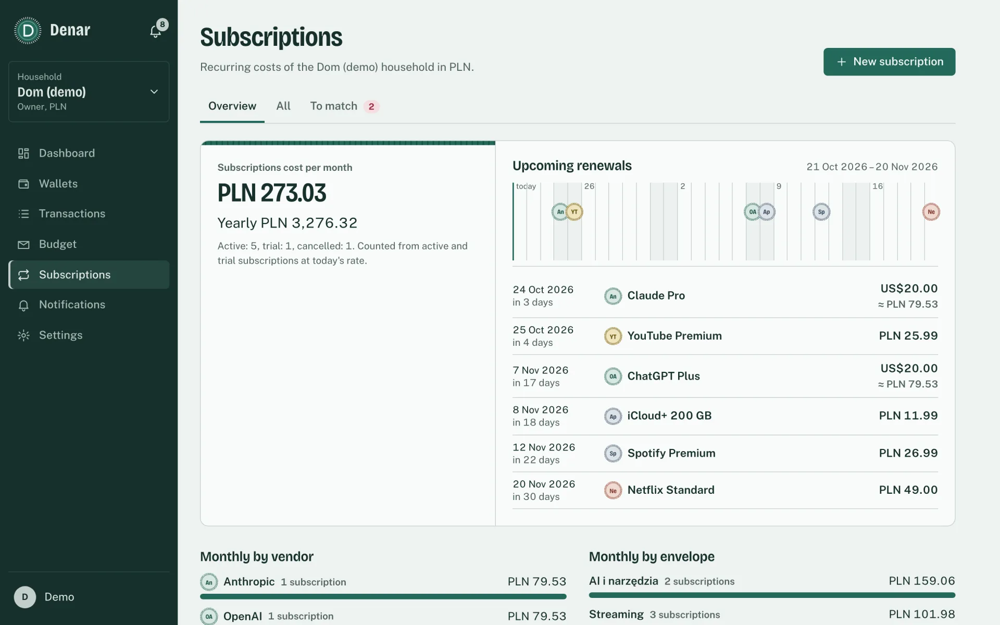
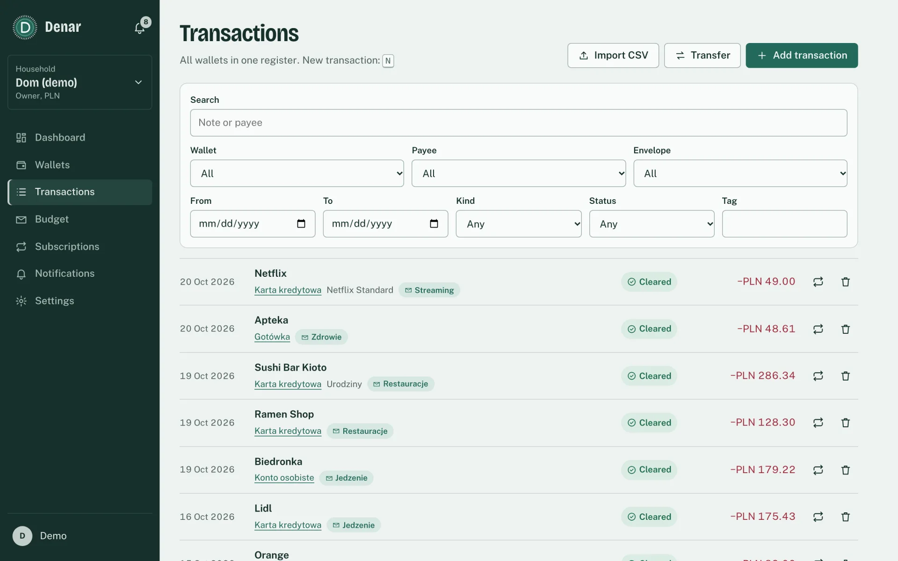
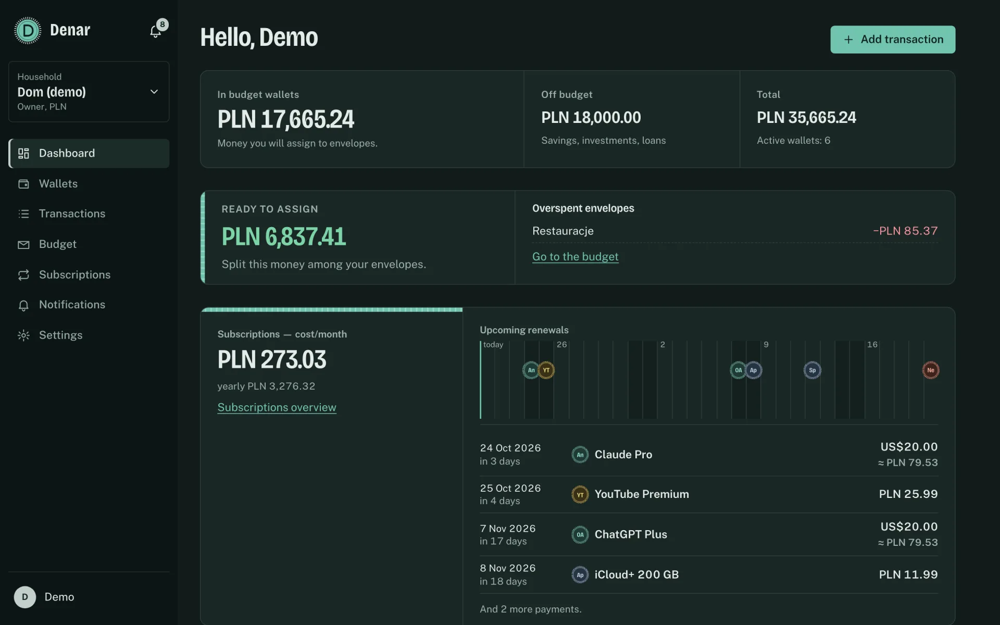

English | [Polski](README.pl.md)

# Denar

[](https://github.com/paramah/denar/actions/workflows/ci.yml)
[](LICENSE)

Self-hosted household budget app with multi-currency wallets, YNAB-style envelopes and subscription tracking, available through a web UI, REST and an MCP server for AI assistants, with separate access rights for household members and bots.

Denar is a single Go binary (Clean Architecture, SQLite) that serves the REST API, the MCP server and the web UI embedded into the binary.

## Screenshots



| | |
|---|---|
|  |  |
| **Envelope budget** (YNAB-style) | **Subscriptions** and upcoming renewals |
|  |  |
| **Transactions** from all wallets | **Dark theme** |

Screenshots come from the local demo (`task demo`); the demo data is in Polish.

## Features

- **Accounts and households:** password login (argon2id) and OIDC with PKCE, sessions, several households per instance with roles `owner/admin/member/viewer`, invitations, audit log.
- **Bots:** tokens `dnr_…` with scopes, used as Bearer tokens in REST and in MCP. A bot never gets more than its creator: it is limited by its scopes, the creator's current role and the wallets the creator can see.
- **Wallets and transactions:** wallets in many currencies (shared and private), transactions with a base-currency amount at the NBP (National Bank of Poland) exchange rate (cache, manual rate, works offline), transfers, splits, payees, balances.
- **Envelope budget (YNAB-style):** groups, envelopes with goals, assignments, moves, auto-assign, Ready-to-Assign with the YNAB overspending rule.
- **Subscriptions:** vendor catalogue, price in any currency, billing cycles without drift, trials, price history, expected charges matched to transactions.
- **Notifications:** in-app, e-mail (SMTP), webhook (with HMAC signature), ntfy, Telegram, Matrix; SSRF protection for outgoing channels.
- **MCP server** for AI assistants (Claude Code, Claude Desktop and other MCP clients).
- **CSV import** of bank statements with presets for mBank, ING, PKO and Revolut, duplicate detection and undo.
- **Web UI in Polish and English:** the language comes from the user's profile, otherwise from the browser (default: Polish). Notifications are written in each recipient's language.

Implemented stages: 001–008 (core, wallets and transactions, envelope budget, subscriptions, notifications, MCP, web UI, CSV import) and 009-hardening-demo (SSRF protection for channels, demo data). Details: `.ai/sdd/PLAN.md`, `.ai/sdd/specs/`.

## Quick start

### Local demo

Requirements: Go 1.27, Node.js (web UI), [Task](https://taskfile.dev), `openssl`.

```sh
task demo
```

This builds the binary with the web UI, creates (or recreates) the database `.dev/demo.db` with demo data and starts the server at **http://localhost:8080**. Log in with:

| Login | Password |
|---|---|
| `demo@denar.local` | `denar-demo-2026` |

> **Note:** the demo password is fixed and public (README, code). It is meant for looking around locally only. Do not expose a demo instance to the network. A different password: `./denar demo --password …` or `DENAR_DEMO_PASSWORD` (applies when the account is first created).

At the end, `task demo` prints the token of the "Asystent AI" bot (read access plus writing transactions) and a ready-made command for Claude Code:

```sh
claude mcp add --transport http denar http://localhost:8080/mcp --header "Authorization: Bearer dnr_…"
```

Every `task demo` run rebuilds the demo household from scratch (`denar demo --reset`), so the bot token changes. The channel secrets key (`.dev/master.key`) is created on the first run.

What to look at in the "Dom (demo)" household (PLN, about 3 months of history):

- **Dashboard:** balances of six wallets (current account, card, cash, USD account, EUR cash, private savings off budget), Ready-to-Assign, upcoming renewals, subscription cost.
- **Budget:** groups Stałe / Codzienne / Subskrypcje / Cele / Przyjemności (fixed, everyday, subscriptions, goals, fun) with assignments for every month; in the current month the **Restauracje** (restaurants) envelope is overspent; goals: Wakacje (holidays, amount by a date) and Poduszka finansowa (emergency fund, monthly).
- **Wallets and transactions:** salary, rent, groceries (Biedronka, Lidl), fuel (Orlen), utilities, restaurants, transfers to savings and a card repayment, PLN → USD and PLN → EUR exchange, a dinner in Berlin paid in EUR. USD/EUR rates are set manually for every day (works without network access and without NBP).
- **Subscriptions:** Netflix, Spotify (with a price increase), ChatGPT Plus and Claude Pro (20 USD from the USD account), iCloud+ (one missed payment), YouTube Premium in a trial ending in a few days, Adobe (cancelled); a match queue with the latest payments to confirm.
- **Notifications:** the bell with unread items: upcoming renewals, trial ending, missed payment, overspent envelope (older ones are read).
- **Settings:** members, the "Asystent AI" bot, notification channels (locally `DENAR_NOTIFY_ALLOW_PRIVATE=true`, so a webhook to n8n on this machine works).
- **MCP:** after `claude mcp add …` ask, for example, "what renews this week?" or "how much did I spend on restaurants this month?".

Demo data on any database: `DENAR_DB=my.db ./denar demo` (refuses when the demo household already exists; `--reset` deletes it and creates it again).

The demo data itself is in Polish.

### Docker

Images for `linux/amd64` and `linux/arm64` are published to the GitHub Container Registry as `ghcr.io/paramah/denar` (tags: `latest`, `<major>.<minor>`, `<version>`):

```sh
docker run -d --name denar -p 127.0.0.1:8080:8080 -v denar-data:/data \
  -e DENAR_AUTO_MIGRATE=true \
  -e DENAR_ADMIN_EMAIL=admin@example.com -e DENAR_ADMIN_PASSWORD='at-least-12-characters' \
  -e DENAR_MASTER_KEY="$(openssl rand -base64 32)" \
  ghcr.io/paramah/denar:latest
```

The image runs as a non-root user, keeps its database in the `/data` volume (`DENAR_DB=/data/denar.db`), listens on port 8080 and has a healthcheck on `/healthz`. Keep the master key: changing it invalidates stored channel secrets.

### Docker Compose

```sh
cp .env.example .env   # set DENAR_ADMIN_PASSWORD (at least 12 characters)
task compose:up
```

This builds the image from the repository and starts the container: port 8080 on 127.0.0.1, data in the `denar-data` volume. Traffic is not encrypted, so expose it to the network through a reverse proxy with TLS, not through this port (`DENAR_BIND`, `DENAR_PORT` in `.env`). Also `task compose:down` (data stays in the volume) and `task compose:logs`. A different engine: `COMPOSE="podman compose" task compose:up`.

### Without Task

```sh
go build -o denar ./cmd/denar
export DENAR_DB=./denar.db DENAR_ADMIN_EMAIL=admin@example.com DENAR_ADMIN_PASSWORD='password-at-least-12'
./denar migrate
./denar serve
```

A plain `go build` embeds the web UI only if `web/dist` has been built before (`task web:build`); release binaries and the Docker image always contain it.

### Commands

| Command | Description |
|---|---|
| `denar serve` | HTTP server (`/api`, `/healthz`, web UI at `/`) |
| `denar migrate` | updates the database schema; without `DENAR_AUTO_MIGRATE`, `serve` refuses to start on an old schema |
| `denar token create …` | creates a bot and prints its token |
| `denar demo [--reset] [--password …]` | migrates the database and creates the demo household with the `demo@denar.local` account (local use only) |
| `denar version` | version |

## Using the REST API

The REST contract is [`api/openapi.yaml`](api/openapi.yaml). A quick check against a running server:

```sh
curl -s localhost:8080/healthz
# log in (session cookie stored in the jar file)
curl -s -c jar -H 'Content-Type: application/json' \
  -d '{"email":"admin@example.com","password":"password-at-least-12"}' localhost:8080/api/auth/login
# household
curl -s -b jar -H 'Content-Type: application/json' \
  -d '{"name":"Dom","base_currency":"PLN","timezone":"Europe/Warsaw","month_start_day":1}' localhost:8080/api/households
# bot (token shown once) and a call as the bot
curl -s -b jar -H 'Content-Type: application/json' \
  -d '{"name":"Claude","scopes":["wallets:read","reports:read"]}' localhost:8080/api/households/<ID>/bots
curl -s -H 'Authorization: Bearer dnr_…' localhost:8080/api/me
# wallet with an opening balance and an expense (amounts are always a decimal string plus a currency)
curl -s -b jar -H 'Content-Type: application/json' \
  -d '{"name":"Konto","type":"checking","currency":"PLN","opening_balance":{"amount":"1000.00","currency":"PLN"}}' \
  localhost:8080/api/households/<ID>/wallets
curl -s -b jar -H 'Content-Type: application/json' \
  -d '{"wallet_id":"<WALLET>","amount":{"amount":"-25.99","currency":"PLN"},"payee_name":"Biedronka"}' \
  localhost:8080/api/households/<ID>/transactions
curl -s -b jar localhost:8080/api/households/<ID>/wallets
```

A transaction in a currency other than the base currency gets a base amount at the NBP rate from the transaction date. Without network access it is saved with `rate_pending: true`, and a job (every `DENAR_FX_INTERVAL`) fills it in later; an owner/admin can also set the rate manually: `PUT /api/households/<ID>/fx-rates/overrides`.

Bot token from the CLI (no UI): `./denar token create --household <ID> --name cron --scopes reports:read [--as email] [--expires 2027-01-01T00:00:00Z]`. The token goes to stdout.

### Envelope budget

Envelopes and assignments are in the household's base currency; a budget month is `YYYY-MM` (starting on `month_start_day`). Envelope activity is computed from transactions in on-budget wallets that carry its `envelope_id` (split lines included); income and expenses without an envelope go straight to Ready-to-Assign. Overspending (negative `available`) resets to zero in the next month and reduces that month's Ready-to-Assign.

```sh
B=localhost:8080/api/households/<ID>/budget
curl -s -b jar -H 'Content-Type: application/json' -d '{"name":"Codzienne"}' $B/envelope-groups
curl -s -b jar -H 'Content-Type: application/json' \
  -d '{"group_id":"<GROUP>","name":"Jedzenie","goal":{"type":"monthly","amount":{"amount":"800.00","currency":"PLN"}}}' $B/envelopes
curl -s -b jar -X PUT -H 'Content-Type: application/json' -d '{"amount":{"amount":"500.00","currency":"PLN"}}' \
  $B/months/2026-10/assignments/<ENVELOPE>
curl -s -b jar -X POST $B/months/2026-10/auto-assign          # fills goals from Ready-to-Assign
curl -s -b jar $B/months/2026-10                              # groups → envelopes, ready_to_assign, incomplete
```

Move money: `POST $B/months/<M>/moves` (`from_envelope_id`, `to_envelope_id`, `amount`); envelope transactions: `GET $B/months/<M>/envelopes/<ENVELOPE>/transactions`. An envelope with transactions cannot be deleted; hide it instead (`PATCH … {"hidden":true}`). Bots need `budget:read`/`budget:write`.

### Subscriptions

A subscription has a vendor from the catalogue (`GET /api/vendors`: openai, anthropic, apple, netflix…, `other`), a price in any currency (it does not have to be the wallet's currency), a cycle `{unit: day|week|month|year, every, anchor}` always counted from `anchor` (31 → 28/29 Feb → 31 Mar, no drift), an optional trial, a payment wallet and an envelope. Subscriptions produce **expected charges** (`charges`) up to `DENAR_CHARGE_HORIZON` days ahead; a job (every `DENAR_SUBSCRIPTION_INTERVAL`) adds the next ones, marks charges still unpaid after the window as `missed` and writes reminders to the event outbox (delivered by the notifications stage, 005).

```sh
S=localhost:8080/api/households/<ID>
curl -s -b jar -H 'Content-Type: application/json' -d '{"name":"ChatGPT Plus","vendor":"openai",
  "price":{"amount":"20.00","currency":"USD"},"cycle":{"unit":"month","anchor":"2026-01-31"},
  "wallet_id":"<WALLET>","envelope_id":"<ENVELOPE>","reminder_offsets":[7,1]}' $S/subscriptions
curl -s -b jar "$S/charges?status=expected&status=missed"          # charge queue
curl -s -b jar $S/charges/<CHARGE>/suggestions                     # transactions scored 0–100
curl -s -b jar -H 'Content-Type: application/json' -d '{"transaction_id":"<TX>"}' $S/charges/<CHARGE>/match
curl -s -b jar -X POST $S/charges/<CHARGE>/post                    # or: post an expense from the charge
curl -s -b jar -H 'Content-Type: application/json' \
  -d '{"effective_from":"2026-12-01","price":{"amount":"25.00","currency":"USD"}}' $S/subscriptions/<SUB>/prices
curl -s -b jar $S/subscriptions/summary                            # monthly/yearly cost in the base currency
curl -s -b jar "$S/subscriptions/upcoming?days=7"                  # what renews
```

Subscription statuses: `trial` (charges from `trial_ends_at`), `active`, `paused` (no charges), `cancelled` (no charges from `ends_at`). Charges: `expected`, `matched`, `missed`, `skipped` (`POST …/skip`), `posted`; `POST …/unmatch` detaches the transaction. For an expense entered by hand, `GET $S/transactions/<TX>/charge-suggestions` returns matching charges. A subscription with a wallet is visible only to those who can see that wallet; without a wallet, to the whole household. Bots need `subscriptions:read`/`subscriptions:write` (suggestions and confirming a match also `transactions:read`, posting `transactions:write`).

## Configuration

Denar is configured with `DENAR_*` environment variables. [`.env.example`](.env.example) is a commented template for Docker Compose.

| Variable | Default | Description |
|---|---|---|
| `DENAR_ADDR` | `:8080` | listen address |
| `DENAR_DB` | `denar.db` | SQLite file |
| `DENAR_ADMIN_EMAIL`, `DENAR_ADMIN_PASSWORD` / `DENAR_ADMIN_PASSWORD_FILE` | — | bootstrap account (created once, password at least 12 characters) |
| `DENAR_ADMIN_NAME` | `Admin` | name of the bootstrap account |
| `DENAR_LOCAL_LOGIN` | `true` | password login |
| `DENAR_BASE_URL` | `http://localhost:8080` | public origin (required with OIDC); invitation links, redirect URI |
| `DENAR_SESSION_TTL` | `168h` | session expiry after inactivity |
| `DENAR_INVITE_TTL` | `168h` | invitation validity |
| `DENAR_OIDC_ISSUER`, `DENAR_OIDC_CLIENT_ID`, `DENAR_OIDC_CLIENT_SECRET` | — | OIDC (all three enable it, e.g. Pocket ID); redirect URI `<BASE_URL>/api/auth/callback` |
| `DENAR_OIDC_AUTO_CREATE` | `false` | an account for every IdP user (otherwise only invited e-mails) |
| `DENAR_AUTO_MIGRATE` | `false` | migrate on `serve` start |
| `DENAR_TRUSTED_PROXIES` | — | CIDRs of trusted reverse proxies (`X-Forwarded-For`), comma-separated |
| `DENAR_INSTANCE_NAME` | `Denar` | name on the login screen (up to 64 characters) |
| `DENAR_BOT_RATE` | `120` | bot request limit per minute (10–6000) |
| `DENAR_NBP_URL` | `https://api.nbp.pl` | NBP exchange rate API (table A) |
| `DENAR_CHARGE_HORIZON` | `90` | how many days ahead to generate expected subscription charges (7–730) |
| `DENAR_SUBSCRIPTION_INTERVAL` | `1h` | how often to run subscription jobs (charges, missed, reminders) |
| `DENAR_FX_INTERVAL` | `30m` | how often to fill in base amounts of transactions saved without a rate |
| `DENAR_MASTER_KEY` / `DENAR_MASTER_KEY_FILE` | — | encryption key for channel secrets: 32 bytes in base64 (`openssl rand -base64 32`) |
| `DENAR_SMTP_HOST` | — | SMTP server (enables the e-mail channel and e-mail invitations) |
| `DENAR_SMTP_PORT` | `587` (`465` for `tls`, `25` for `none`) | SMTP port |
| `DENAR_SMTP_USERNAME`, `DENAR_SMTP_PASSWORD` / `DENAR_SMTP_PASSWORD_FILE` | — | SMTP login (AUTH PLAIN, only over TLS) |
| `DENAR_SMTP_FROM` | — | sender, e.g. `Denar <denar@example.com>` (required with SMTP) |
| `DENAR_SMTP_TLS` | `starttls` | `starttls`, `tls` (from the start) or `none` (relay in a trusted network) |
| `DENAR_NOTIFY_INTERVAL` | `30s` | how often to dispatch events and send deliveries |
| `DENAR_BUDGET_CHECK_INTERVAL` | `15m` | how often to check envelopes (overspending, goal deadlines) |
| `DENAR_GOAL_DUE_DAYS` | `7` | how many days before an envelope goal deadline to remind (1–60) |
| `DENAR_TELEGRAM_API_URL` | `https://api.telegram.org` | Telegram Bot API address (e.g. your own Bot API server; on a local network it needs `DENAR_NOTIFY_ALLOWED_CIDRS`) |
| `DENAR_NOTIFY_ALLOW_PRIVATE` | `false` | notification channels may send to private networks and loopback (not link-local); see [SSRF protection](#ssrf-protection) |
| `DENAR_NOTIFY_ALLOWED_CIDRS` | — | networks (CIDRs or addresses, comma-separated) channels may send to despite the block, e.g. `192.168.1.0/24` |
| `DENAR_DEV_FAKE_CONNECTOR` | `false` | adds a fake bank `fake` to the connection providers (development only, never in production) |

Docker Compose only: `DENAR_PORT` (published port, `8080`), `DENAR_BIND` (host address, `127.0.0.1`; change to `0.0.0.0` only in a trusted network, traffic is not encrypted), `DENAR_VERSION` (image tag and build version). `denar demo` also reads `DENAR_DEMO_PASSWORD`.

## MCP: connecting Claude and other AI assistants

The MCP server runs at `http://localhost:8080/mcp` (Streamable HTTP, stateless, JSON responses). It authenticates **only bot tokens**: `Authorization: Bearer dnr_…`. A bot belongs to one household, so the tools do not ask for it; it sees and changes only what its scopes, its creator's current role (a viewer's bot can only read) and its wallet list allow. A bot's changes go to the audit log, and its transactions have `source: bot`. Full contract: [`api/mcp-tools.md`](api/mcp-tools.md).

1. Create a bot (Settings → Bots in the web UI, `POST /api/households/<ID>/bots` or the CLI) with the scopes it needs, for example a spending assistant:
   ```sh
   ./denar token create --household <ID> --name Claude \
     --scopes wallets:read,transactions:read,transactions:write,budget:read,budget:write,subscriptions:read,subscriptions:write,reports:read
   ```
2. Connect the client:
   - **Claude Code:**
     ```sh
     claude mcp add --transport http denar http://localhost:8080/mcp --header "Authorization: Bearer dnr_…"
     ```
   - **Claude Desktop / claude.ai and other clients with remote MCP:** add an HTTP server at `https://<your-instance>/mcp` with the header `Authorization: Bearer dnr_…`. A client without header support can use a bridge, e.g. in `claude_desktop_config.json`:
     ```json
     { "mcpServers": { "denar": { "command": "npx",
         "args": ["-y", "mcp-remote", "http://localhost:8080/mcp", "--header", "Authorization: Bearer dnr_…"] } } }
     ```
3. Ask, for example, "what renews this week?" or "I spent 42.50 at Biedronka with the card on food".

Tools (wallets, envelopes, payees and subscriptions by id or by name; amounts as `"12.34"`, dates `YYYY-MM-DD`, months `YYYY-MM`):

| Tool | Scope |
|---|---|
| `whoami`, `list_vendors` | — |
| `list_wallets`, `get_balances` | `wallets:read` |
| `search_transactions`, `list_payees` | `transactions:read` |
| `record_expense`, `record_income`, `transfer` | `transactions:write` (charge suggestions after `record_expense` also need `subscriptions:read`, `transactions:read`) |
| `list_envelopes`, `budget_overview` | `budget:read` |
| `assign_to_envelope`, `move_between_envelopes` | `budget:write` |
| `spending_by` (envelope / payee / vendor / wallet) | `reports:read` |
| `list_subscriptions`, `get_subscription`, `upcoming_renewals`, `subscription_costs`, `list_charges` | `subscriptions:read` |
| `create_subscription`, `update_subscription`, `change_subscription_price`, `skip_charge` | `subscriptions:write` |
| `confirm_charge_match` | `subscriptions:write` + `transactions:read` |
| `post_charge` | `subscriptions:write` + `transactions:write` |
| `list_notifications` (notifications of the bot's creator) | `notifications:read` |
| `list_imports` | `transactions:read` |

A missing scope gives a `forbidden` error naming the missing scope. Rate limit: `DENAR_BOT_RATE` requests per minute (counted separately for MCP and REST).

## Notifications

Events (renewal in N days, trial ending, price change, missed payment, overspent envelope, approaching envelope goal deadline) go to an outbox, and a job every `DENAR_NOTIFY_INTERVAL` turns them into **in-app notifications** and **channel deliveries** chosen in the preferences. Recipients: household members (any role) who can see the event's wallet; a subscription from a private wallet does not reach those who cannot see it. Notifications are written in the recipient's language (Polish or English) and link to the web UI (`DENAR_BASE_URL`).

- **Channels** (per user, `/api/me/channels`): `email` (address, the account e-mail by default; requires SMTP), `webhook` (POST JSON, optional HMAC secret → header `X-Denar-Signature: sha256=<hex>`), `ntfy` (server, topic, optional token), `telegram` (chat id + bot token), `matrix` (homeserver, room id `!…:server`, access token). "Send test": `POST /api/me/channels/<id>/test`.
- **Preferences** (per user and household, `/api/me/households/<ID>/notification-preferences`): for every event type, in-app yes/no and a list of channels. Default: everything in-app, no channels.
- **Secrets** of channels (tokens, HMAC key) are encrypted with AES-256-GCM using `DENAR_MASTER_KEY` and never come back from the API (`has_secret`). Without the key, channels with secrets are unavailable; e-mail, in-app, unsigned webhooks and ntfy without a token work. Key: `openssl rand -base64 32`. Changing the key invalidates stored secrets (they have to be set again).
- **Retries:** a failed delivery is retried after 1, 2, 4, 8, 16 minutes; after 6 attempts it is `failed`, and the channel shows `last_error`.
- **Retention:** read notifications are removed after 180 days, finished deliveries after 30, events after 400.
- **E-mail invitations:** with SMTP configured, `POST /api/households/<ID>/invitations` with `"send_email": true` sends the link (`email_sent` in the response).

### SSRF protection

Webhook, ntfy and Matrix channels send only to public addresses. The server rejects loopback addresses, private networks (RFC 1918), link-local (including `169.254.169.254`, the cloud metadata endpoint), CGNAT `100.64.0.0/10`, ULA `fc00::/7`, multicast, unspecified addresses and IPv4-mapped IPv6 addresses. The check runs twice: when the channel is saved (a literal IP or `localhost` → 422 "target address not allowed (private network), see DENAR_NOTIFY_ALLOW_PRIVATE") and on every connection, on the address after DNS resolution, so a name pointing to the local network (also after DNS rebinding) does not get through either. Proxy variables (`HTTP(S)_PROXY`) are not used by notifications, and redirects are not followed.

Self-hosted ntfy, n8n or Home Assistant on your LAN? This is an explicit opt-in. Open only its network with `DENAR_NOTIFY_ALLOWED_CIDRS=192.168.1.0/24` (recommended), or all private networks with `DENAR_NOTIFY_ALLOW_PRIVATE=true` (link-local stays closed; only an explicit CIDR opens it). Remember that every user of the instance can then send requests to those networks. A channel error (`last_error`, the "Send test" result) is only `HTTP <code>`; the response body goes to the server log only.

```sh
# ntfy: notifications on your phone (ntfy app, subscribe to the topic denar-dom-7f3a)
curl -s -b jar -H 'Content-Type: application/json' localhost:8080/api/me/channels \
  -d '{"type":"ntfy","name":"Telefon","config":{"topic":"denar-dom-7f3a"}}'
# Telegram: create a bot with @BotFather, message it, read chat_id from https://api.telegram.org/bot<TOKEN>/getUpdates
curl -s -b jar -H 'Content-Type: application/json' localhost:8080/api/me/channels \
  -d '{"type":"telegram","name":"Telegram","config":{"chat_id":"123456789"},"secrets":{"bot_token":"123:ABC…"}}'
curl -s -b jar -X POST localhost:8080/api/me/channels/<CH>/test        # {"ok":true,…}
# renewals to Telegram and in-app, everything else in-app only
curl -s -b jar -X PUT -H 'Content-Type: application/json' localhost:8080/api/me/households/$H/notification-preferences \
  -d '{"items":[{"type":"subscription.renewal_upcoming","in_app":true,"channel_ids":["<CH>"]}]}'
curl -s -b jar 'localhost:8080/api/me/notifications?unread=true'
```

Verifying a webhook signature: `HMAC-SHA256(secret, raw body)` in hex, compared in constant time with the value after `sha256=`; `X-Denar-Delivery` is the delivery id (a retry has the same id).

## CSV import

A bank statement (CSV) goes into a wallet through a preview and an import. Every row becomes a transaction with `source=import` (negative amount: expense, positive: income, status `cleared`); the payee and envelope come from payee rules (a name or a pattern in the raw description), the raw description stays in the memo, and new transactions are immediately matched to expected subscription charges (threshold 80 points, as in the suggestions). Duplicates are skipped by `external_id`: from the file's ID column or, without one, a hash of the date, amount, description and occurrence number in the file, so uploading the same file again adds nothing. A batch can be undone (it deletes its transactions and detaches charges).

- **Presets** (`GET /api/import-presets`): `generic` (detects encoding, delimiter, date and number format, columns by common names), `mbank`, `ing`, `pko`, `revolut`. The bank presets were written from descriptions of the export formats and tested on synthetic samples; if your bank changed its columns, override the mapping in the options (`columns`).
- **Options** (the `options` part, JSON): `wallet_id` (required), `preset`, `delimiter` (`;`, `,`, `|`, `tab`), `encoding` (`utf-8`, `windows-1250`), `date_format` (e.g. `DD.MM.YYYY`), `decimal_separator` (`,`, `.`), `skip_rows`, `has_header`, `invert_amount`, `accept_states`, `columns` (`date`, `amount` or `debit`/`credit`, `payee`, `memo`, `external_id`, `currency`, `fee`, `state`: lists of header names or 1-based column numbers), and in the preview `preview_limit`.
- **Limits:** files up to 5 MiB, up to 10,000 rows; bad rows (wrong date, amount, a currency other than the wallet's) do not stop the import; they are listed in the batch's `errors`.
- **Permissions:** import and undo need `transactions:write` (bots too, through REST); listing batches needs `transactions:read`; automatic subscription matching additionally needs `subscriptions:write`. MCP: `list_imports`.

```sh
# preview: first rows, duplicates, errors, detected encoding and header
curl -s -b jar localhost:8080/api/households/$H/imports/csv/preview \
  -F file=@lista_operacji.csv -F 'options={"wallet_id":"<W>","preset":"mbank"};type=application/json'
# import (201: counters created/duplicate/error/matched)
curl -s -b jar localhost:8080/api/households/$H/imports/csv \
  -F file=@lista_operacji.csv -F 'options={"wallet_id":"<W>","preset":"mbank"};type=application/json'
# custom mapping for a file without a header: date in column 1, description in 2, amount in 4
curl -s -b jar localhost:8080/api/households/$H/imports/csv \
  -F file=@eksport.csv -F 'options={"wallet_id":"<W>","has_header":false,"delimiter":";","date_format":"DD.MM.YYYY","columns":{"date":["1"],"payee":["2"],"amount":["4"]}}'
curl -s -b jar localhost:8080/api/households/$H/imports            # batches
curl -s -b jar -X DELETE localhost:8080/api/households/$H/imports/<ID>   # undo
```

**Connections to banks and providers** (PSD2, OpenAI, Apple) currently exist only as a model and ports (`BankConnector`, `BillingConnector`); `GET /api/households/<ID>/connections` and `GET /api/connection-providers` are read-only. `DENAR_DEV_FAKE_CONNECTOR=1` adds a fake bank `fake` for development.

## Development

Requirements: Go 1.27, Node.js 22 (`web/.nvmrc`), [Task](https://taskfile.dev), `openssl`.

```sh
cp .env.dev.example .env.dev      # set DENAR_ADMIN_PASSWORD (at least 12 characters)
task dev                          # API on :8080 (database .dev/denar.db) and Vite with HMR at http://localhost:5173
```

API only: `task dev:api`; frontend only: `task web:dev`. Demo data in the development database: `DENAR_DB=.dev/denar.db go run ./cmd/denar demo`.

```sh
task verify     # gofmt, go vet, web build + tests, go test -race, go build
task generate   # regenerate code from api/openapi.yaml
task web:types  # regenerate web/src/api/schema.d.ts from api/openapi.yaml (task web:types:check verifies it)
task web:e2e    # build the binary with the web UI and run the Playwright tests
```

Before the first `task web:e2e`, install the browser once: `task web:e2e:install`. CI (GitHub Actions) runs `task web:types:check`, `task verify` and `task web:e2e` on every push to `main` and on pull requests.

## Architecture

- **One binary:** `cmd/denar` (commands `serve`, `migrate`, `token`, `demo`, `version`); the React SPA from `web/` is built by Vite into `web/dist` and embedded with `go:embed` (`web/embed.go`).
- **Clean Architecture:** dependencies point inwards only, `adapter → usecase → domain` (enforced by `internal/arch_test.go`). Business rules (balances, envelopes, subscription cycles, permissions) live in `internal/domain` and `internal/usecase`, not in the adapters.
- **Money** is always an `int64` in minor units plus a currency; never `float64`.
- **Storage:** SQLite (pure Go driver, no CGO) with migrations.
- **Interfaces:** REST ([`api/openapi.yaml`](api/openapi.yaml), with code generated by oapi-codegen), MCP ([`api/mcp-tools.md`](api/mcp-tools.md)) and the web UI on top of REST.
- **Access control:** every use case filters by the wallets the principal can see; hidden resources return "not found". Bots never get more than their creator.

## Project process

Denar is developed spec-first. Product and technical steering is in `.ai/steering/`, the plan in `.ai/sdd/PLAN.md` and the specification of each stage (requirements, design, tasks) in `.ai/sdd/specs/NNN-*/`. These documents are written in Polish. Instructions for coding agents: [`AGENTS.md`](AGENTS.md).

## License

[MIT](LICENSE) © 2026 Aleksander Cynarski
